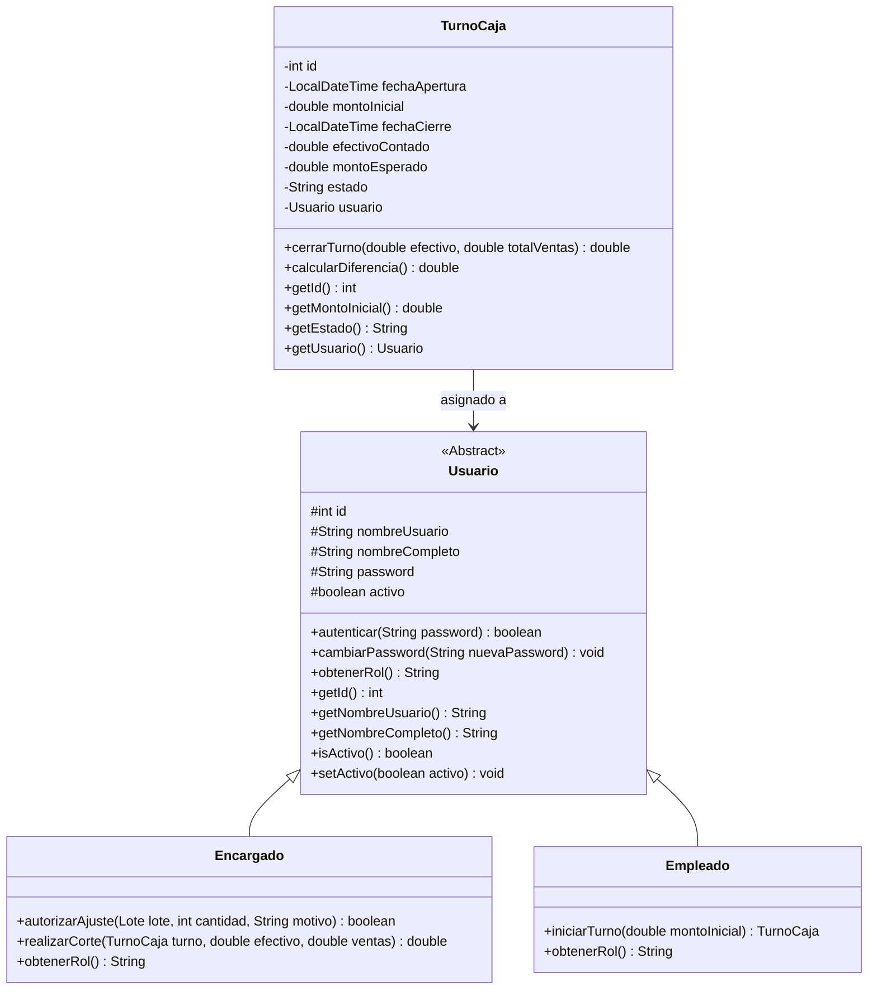
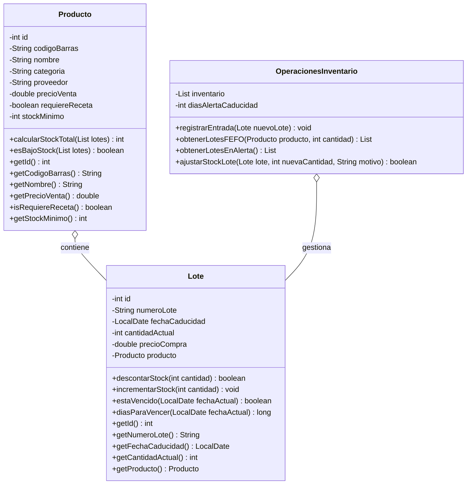
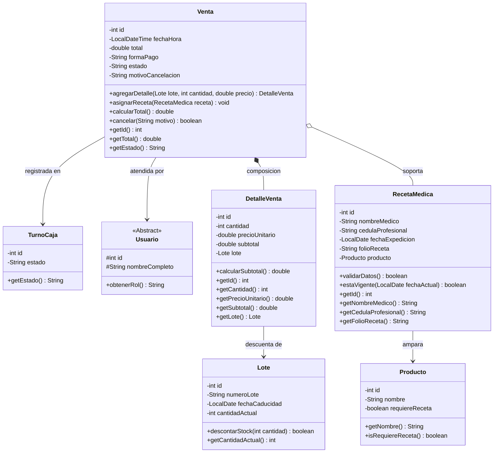

# Diagrama de Clases — Farmac

Diagrama UML de clases del sistema, representando herencia, composicion, agregacion y asociaciones entre las 10 clases del dominio.

---

## Diagrama 1 — Jerarquia de Usuarios y Turno de Caja

---

## Diagrama 2 — Inventario

---

## Diagrama 3 — Ventas y Recetas

---

> Los diagramas tambien estan disponibles en texto plano en `DIAGRAMA_1_USUARIOS.txt`, `DIAGRAMA_2_INVENTARIO.txt` y `DIAGRAMA_3_VENTAS.txt` para pegar directamente en [mermaid.live](https://mermaid.live/edit).
