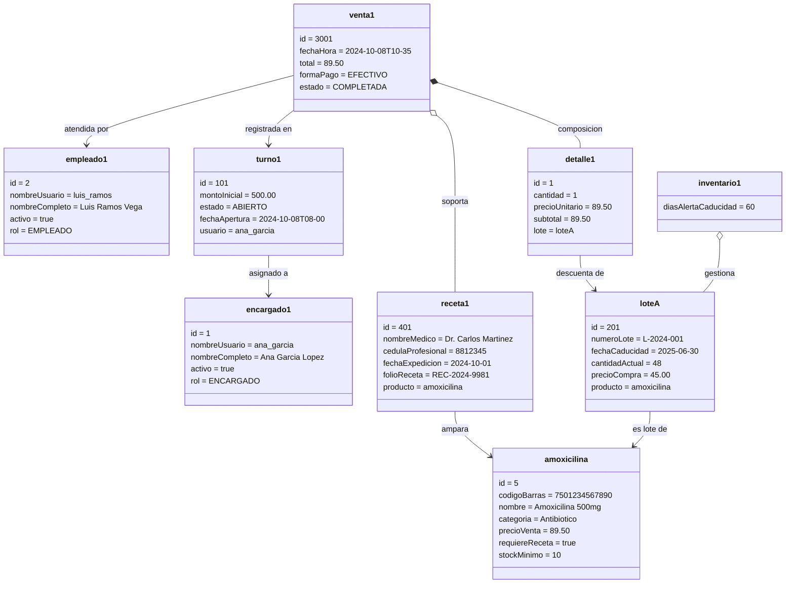

# Diagrama de Objetos — Farmac

Escenario de ejecucion: **venta de un antibiotico con receta medica** atendida por el cajero "Luis Ramos" en turno abierto por el encargado.

---

## Escenario representado

1. El encargado `ana_garcia` tiene un turno de caja abierto con fondo inicial de \$500.
2. El cajero `luis_ramos` atiende la venta.
3. Se vende 1 caja de Amoxicilina (requiere receta) del lote L-2024-001.
4. El sistema registra la receta del Dr. Martinez.
5. La venta queda completada con total de \$89.50.

---

---

## Notas del escenario

| Objeto | Clase | Descripcion |
|---|---|---|
| `encargado1` | `Encargado` | Abre el turno, autoriza ajustes de inventario |
| `empleado1` | `Empleado` | Atiende la venta en caja |
| `turno1` | `TurnoCaja` | Turno ABIERTO con fondo de \$500 |
| `amoxicilina` | `Producto` | Medicamento controlado, requiere receta |
| `loteA` | `Lote` | Partida fisica con caducidad 2025-06-30 (FEFO vigente) |
| `venta1` | `Venta` | Transaccion completada por \$89.50 |
| `detalle1` | `DetalleVenta` | Renglon de la venta, compuesto dentro de `venta1` |
| `receta1` | `RecetaMedica` | Capturada en el dialogo de receta, vigente 30 dias |
| `inventario1` | `OperacionesInventario` | Gestiona el lote con alerta de 60 dias |
